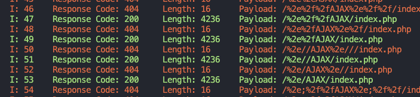
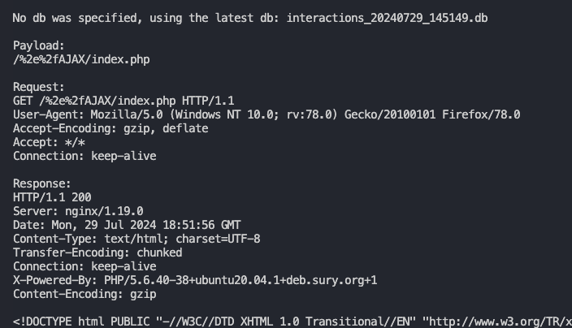
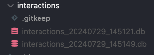

# BypassFuzzer

**HTTP 401/403 Bypass Fuzzing Tool**

BypassFuzzer is a Python-based security testing tool designed to identify potential access control weaknesses in web applications.

Perform various security checks using HTTP headers, path normalization, HTTP methods, and other techniques to test potential bypasses in restricted endpoints.

### Features

- **HTTP 401/403 Fuzzing:** Test endpoints returning unauthorized or forbidden responses.
- **Header Manipulation:** Test alternative HTTP headers.
- **Path Normalization:** Test URL encoding and path variations.
- **HTTP Method Testing:** Test different HTTP verbs.
- **Burp Suite Integration:** Import raw HTTP requests directly from Burp Suite.
- **Smart Filter:** Automatically suppress repeated responses.
- **Custom Headers & Cookies:** Configure authentication and request parameters.
- **Proxy Support:** Route requests through Burp Suite.
- **Response Filtering:** Hide specific HTTP status codes or response lengths.
- **Interaction Database:** Save successful HTTP 200 interactions in SQLite.
- **OOB / Blind SSRF Testing:** Support out-of-band callback domains.

---

## Installation

### Linux / Kali Linux / macOS

Clone the repository:

```bash
git clone https://github.com/CAZZB/bypassfuzz.git
cd bypassfuzz
```

Create a virtual environment:

```bash
python3 -m venv .venv
```

Activate the environment:

```bash
source .venv/bin/activate
```

Install dependencies:

```bash
python3 -m pip install -r requirements.txt
```

### Windows

Clone the repository:

```bash
git clone https://github.com/CAZZB/bypassfuzz.git
cd bypassfuzz
```

Create a virtual environment:

```powershell
py -m venv .venv
```

Activate it:

```powershell
.venv\Scripts\activate
```

Install dependencies:

```powershell
python -m pip install -r requirements.txt
```

---

## Usage

Display the help menu:

```bash
python3 bypassfuzzer.py -h
```

### Specifying a Request

**Recommended method: Import a raw HTTP request from Burp Suite.**

Save the captured request into a file and execute:

```bash
python3 bypassfuzzer.py -r request.txt
```

The tool automatically parses cookies and headers from the request.

### Specify a URL

```bash
python3 bypassfuzzer.py -u https://example.com/forbidden
```

### Specify Cookies

```bash
python3 bypassfuzzer.py -u https://example.com/forbidden -c "session=123456; user=admin"
```

### Specify HTTP Methods and Request Body

```bash
python3 bypassfuzzer.py -u https://example.com/forbidden -m POST -d "param1=value1&param2=value2"
```

```bash
python3 bypassfuzzer.py -u https://example.com/forbidden -m PUT -d "param1=value1&param2=value2"
```

### Custom HTTP Headers

```bash
python3 bypassfuzzer.py -u https://example.com/forbidden \
-H "Some-Header: value" \
-H "Authorization: Bearer YOUR_TOKEN"
```

### Smart Filter

Automatically suppress repeated responses based on HTTP status code and response length.

```bash
python3 bypassfuzzer.py -u https://example.com/forbidden --smart
```

By default, responses repeated eight times or more are muted.

**Note:** Cannot currently be used simultaneously with `-hc` or `-hl`.

### Proxy Support

```bash
python3 bypassfuzzer.py -u https://example.com/forbidden --proxy http://127.0.0.1:8080
```

Useful for routing requests through Burp Suite.

### Skip Payload Categories

Skip header payloads:

```bash
python3 bypassfuzzer.py -u https://example.com/forbidden -sh
```

Or:

```bash
python3 bypassfuzzer.py -u https://example.com/forbidden --skip-headers
```

Skip URL normalization payloads:

```bash
python3 bypassfuzzer.py -u https://example.com/forbidden -su
```

Or:

```bash
python3 bypassfuzzer.py -u https://example.com/forbidden --skip-urls
```

### Hide Response Codes and Lengths

Hide specific HTTP status codes:

```bash
python3 bypassfuzzer.py -u https://example.com/forbidden -hc 403,404,400
```

Hide specific response lengths:

```bash
python3 bypassfuzzer.py -u https://example.com/forbidden -hl 638
```

---

## Interaction Database

Every successful HTTP 200 request/response interaction is saved in a SQLite database.

Each interaction receives an index number for easier querying.

### Display by Index

```bash
python3 bypassfuzzer.py --display-by index --display-interactions 49
```

### Display by Payload

```bash
python3 bypassfuzzer.py --display-by payload --display-interactions "/%2e%2fAJAX/index.php"
```

### Select a Specific Database

Every execution creates a new database inside the `interactions` directory.

By default, the newest database is used.

To select a specific database:

```bash
python3 bypassfuzzer.py --display-by index --display-interactions 49 --idb interactions_20240729_145149.db
```

**Note:**
- The database must be inside the `interactions` directory.
- If `--idb` is not specified, the newest database is selected.

### Screenshots

**Interaction indexes**



**Request and response details**



**Interactions directory**



---

## OOB / Blind SSRF Testing

BypassFuzzer supports out-of-band callback testing using the `--oob` argument.

Specify your authorized Collaborator or OAST domain:

```bash
python3 bypassfuzzer.py -u https://example.com/forbidden --oob abc123.oastify.com
```

You must manually monitor your OAST service for incoming callbacks.

---

## Roadmap

- [ ] HTTP/2 support
- [ ] Additional bypass techniques
- [ ] Improved response analysis
- [ ] Configurable Smart Filter
- [ ] Advanced reporting capabilities

---

## Security Disclaimer

BypassFuzzer is intended exclusively for authorized penetration testing, security research, and educational purposes.

Only test systems you own or have explicit permission to assess.

The author is not responsible for misuse or unauthorized use of this tool.

## Author

**CAZZB**

GitHub: [@CAZZB](https://github.com/CAZZB)

## Repository

[https://github.com/CAZZB/bypassfuzz](https://github.com/CAZZB/bypassfuzz)
